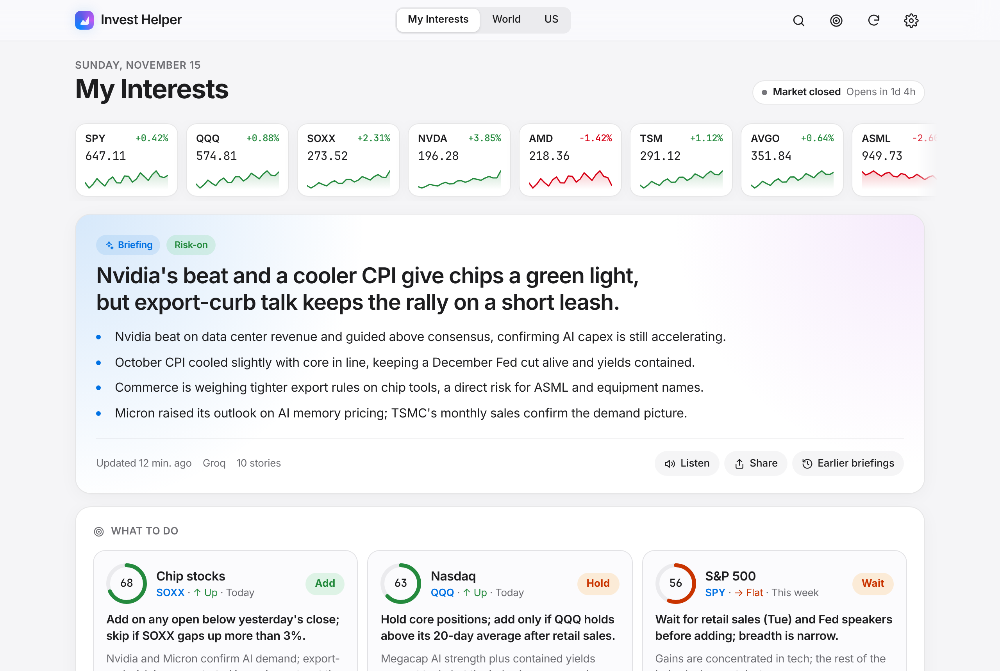

# Invest Helper

A personal news site that catches you up on market news fast and tells you what it likely means for the stocks you follow.

<p align="center">
  
  
</p>

<sub>Screenshots use sample data.</sub>

Three sections, each with its own news feed:

1. **My Interests**: Nasdaq, S&P 500 and chip stocks by default. Edit them in Settings → Interests and the news and analysis follow.
2. **World**: geopolitics, foreign economies, central banks, oil, trade.
3. **US**: Fed, economic data, Congress, the White House, regulation.

Every section opens with an AI briefing, ordered by what helps you act fastest:

- **Briefing**: the one-line takeaway, a risk-on/risk-off mood, and the main events.
- **What to do**: for each interest, a direction call, a confidence ring, an action (Buy / Add / Hold / Wait / Trim / Sell / Avoid), a concrete trigger, and the risks.
- **Movers**: why your biggest movers moved, from the headlines.
- **Key events**: why each event matters, impact per interest, a **past example** of how markets reacted to something similar, and **what could go wrong**.
- **Up next**: earnings for your tickers plus FOMC, CPI, jobs and PPI dates, all fed to the AI so its timing advice knows what's coming.
- **Headlines**: new-since-last-visit dots, "Key" badges on stories the AI used, "+N more" when many outlets ran the story, search, and saved headlines.

Also included:

- light / dark / system theme;
- 8 interface languages (English, Tiếng Việt, 简体中文, 日本語, 한국어, Español, Français, Deutsch);
- a separate language setting for the AI briefings;
- listen to the briefing (text to speech);
- share / copy the briefing;
- the last 10 briefings per section;
- a ticker detail sheet with chart;
- the macro strip (VIX, 10Y yield, oil, gold, dollar, Bitcoin);
- a market open/close countdown;
- keyboard shortcuts;
- install to your phone's home screen as an app.

Design notes and the reasoning behind each feature: [`docs/PLAN.md`](docs/PLAN.md).

## The part that keeps the AI honest: the track record


A confidence number means nothing unless you know how often it's right. Every outlook in My Interests is logged as a call on the **next session that hasn't opened yet**, so the AI never gets to peek at the market's reaction. Each call is then graded against the real close ("today" calls on the next close, "this week" calls on the 5th close).

The calibration chart compares what the AI claimed (line) with how often it was right (bar). These numbers go back into the prompt on every run so the model can recalibrate. Give it a few weeks before you trust them.

<br clear="right" />

## How it works

```
GitHub Actions cron (5x/day, free) ──► /api/refresh on Vercel
                                          │
         ┌────────────────────────────────┼─────────────────────────────┐
         ▼                                ▼                             ▼
  News: Google News RSS per interest,  Prices: Yahoo chart API      Track record:
  Yahoo per-ticker RSS, CNBC,          (Stooq fallback)             grade past calls
  MarketWatch, BBC, NPR, Al Jazeera,
  optional Finnhub
         │  dedupe near-duplicate headlines, tag by interest
         ▼
  AI analysis: Claude → Groq → Gemini → rule-based (first one that works)
  with a curated playbook of historical market reactions + your track record
         │
         ▼
  Upstash Redis (digests, interests, calls) ──► the web page
```

- **Provider chain.** Free today, Claude later. Free providers get a compact prompt (fewer headlines, only the relevant playbook entries, capped output) so a run stays under their tokens-per-minute limits. With no keys at all you get a rule-based keyword read, which is useful for testing and not much else. Add a free Groq or Gemini key for real analysis. Add `ANTHROPIC_API_KEY` and Claude takes over automatically. If a provider fails (rate limit, outage, bad JSON), the next one runs, and the page shows which one produced the briefing.
- **Historical playbook** (`src/lib/analogs.ts`): a hand-checked list of past events and how markets reacted (CPI surprises, Fed pivots, tariff shocks, DeepSeek, export controls, and more). The AI is told to prefer these over its own memory, which cuts down on invented history. Add your own entries.
- **Scheduler.** Vercel's free plan only allows one cron per day, so a GitHub Actions workflow calls the app before the open (twice), at midday, after the close, and on Sunday evening. Vercel's daily cron is a backup.

## Setup (about 15 minutes, all free)

1. **Get a free AI key**: [Groq](https://console.groq.com/keys) (recommended, generous limits) and/or [Gemini](https://aistudio.google.com/apikey). Having both gives you a fallback.
2. **Deploy to Vercel**: [vercel.com/new](https://vercel.com/new) → import this repo → Deploy.
3. **Add storage**: in the Vercel project, open Storage → Marketplace → **Upstash for Redis** → free plan → connect to the project. This adds `KV_REST_API_URL` and `KV_REST_API_TOKEN`. Without it, data is lost whenever Vercel recycles the server.
4. **Environment variables** (Vercel → Settings → Environment Variables), see `.env.example`:
   - `GROQ_API_KEY` and/or `GEMINI_API_KEY`
   - `APP_PASSWORD`: anything you like. The site asks for it once per browser, which keeps strangers from burning your AI quota.
   - `CRON_SECRET`: a long random string (`openssl rand -hex 24`)
   - optional `FINNHUB_API_KEY` ([free](https://finnhub.io)) for extra ticker-tagged company news

   Then redeploy.
5. **Turn on the scheduler**: GitHub repo → Settings → Secrets and variables → Actions → add `APP_URL` (your Vercel URL, e.g. `https://invest-helper-xyz.vercel.app`) and `CRON_SECRET` (same value as in Vercel). Run it once by hand from the Actions tab → "Refresh briefings" → Run workflow.
6. Open the site, enter your password, and press **↻ Refresh** on any section.

### Adding Claude later

Set `ANTHROPIC_API_KEY` in Vercel and redeploy. It defaults to `claude-opus-5-5`. Rough cost: 3 sections × 5 runs a day is about 15 calls a day, roughly $1-2 a day on Opus at the default effort (about $25-40 a month). Set `CLAUDE_MODEL=claude-sonnet-5-5` to cut that roughly in half, or `claude-haiku-5-5` for pennies. Run them side by side for a while and let the track record decide.

## Keyboard shortcuts

| Key | Action |
|---|---|
| `1` `2` `3` | Switch section |
| `R` | Refresh this section |
| `/` | Search headlines |
| `L` | Listen to the briefing |
| `T` | Track record |
| `D` | Toggle light/dark |
| `?` | Show shortcuts |

## Install on your phone

Open the site in Safari (iPhone) or Chrome (Android) → Share → **Add to Home Screen**. It opens full screen like an app.

## Local development

```bash
npm install
cp .env.example .env.local   # fill in at least one AI key
npm run dev                  # http://localhost:3000
npm run refresh              # run the pipeline once from the terminal
npm test                     # offline tests: translations, pipeline, calendar, LLM path and fallback
```

Locally, data is stored as JSON in `.data/`.

## Customizing

- **Interests**: in the app. Name, news search (Google News syntax: `OR`, `"quoted phrases"`), tickers. The first ticker is the benchmark used for the outlook and track record. ETFs work well for themes: QQQ, SPY, SOXX, SMH, XLE, XLF, IBIT.
- **World/US feeds**: `SECTION_FEEDS` in `src/lib/config.ts`.
- **Analyst behavior**: `SYSTEM_PROMPT` in `src/lib/llm/prompt.ts`.
- **Refresh times**: `.github/workflows/refresh.yml` (cron is in UTC).

## Known limits, stated plainly

- Headlines only, no full articles. The AI sees what a fast reader would see, not paywalled analysis.
- Free feeds and the Yahoo price endpoint are unofficial and can change or rate-limit. Failures show up under "feed(s) failed", and the app keeps going with whatever loaded.
- Free LLM tiers change their limits and models often. If one starts failing, the fallback note on the page will say so. Swap the model via `GROQ_MODEL` / `GEMINI_MODEL`.
- The grading is a simple direction check. It doesn't measure how big a move was or whether a trade would have made money after costs.
- AI predictions from public news. They will be wrong regularly. Not financial advice.
