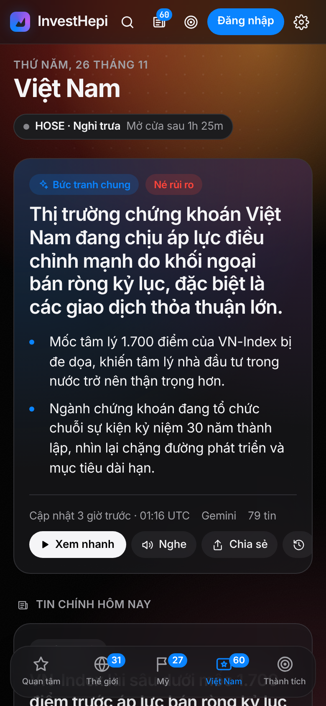

# InvestHepi

**Nắm nhanh những tin quan trọng, hiểu rõ chúng và thấy tác động lên thị trường.** InvestHepi gom tin từ nhiều báo thành từng câu chuyện, để AI giải thích mỗi câu chuyện cho người đọc tò mò (dù có hay không có kiến thức tài chính), và cho thấy tác động lên thị trường bằng giá thật. Một phần riêng đưa ra dự đoán mua / giữ / chờ, được chấm điểm công khai sau mỗi phiên.

**Trang web: [investhepi.vercel.app](https://investhepi.vercel.app)** · [English](README.md) · [Giới thiệu](https://investhepi.vercel.app/about?lang=vi)

  

Ứng dụng chạy hoàn toàn trên các gói miễn phí (Vercel Hobby, Upstash Redis, Groq và Gemini) và có giao diện 8 ngôn ngữ. Người đọc Việt Nam được ưu tiên.

> Dự đoán do AI tạo từ tin tức công khai và thường xuyên sai. Không có gì ở đây là lời khuyên đầu tư.

## Có gì trên trang

| Mục | Nội dung | Ngôn ngữ viết |
|---|---|---|
| **Thế giới** | Địa chính trị, kinh tế các nước, ngân hàng trung ương, dầu, thương mại, cùng tin khoa học và sức khỏe | Tiếng Anh, dịch sẵn sang tiếng Việt |
| **Mỹ** | Fed, số liệu kinh tế, Quốc hội, Nhà Trắng, doanh nghiệp | Tiếng Anh, dịch sẵn sang tiếng Việt |
| **Việt Nam** | VN-Index, ngân hàng và cổ phiếu lớn, Ngân hàng Nhà nước, tỷ giá USD/VND, cùng tin khoa học và văn hóa | Tiếng Việt |
| **Danh mục của tôi** | Cổ phiếu và chủ đề bạn theo dõi (cần đăng nhập) | Dịch theo ngôn ngữ của bạn |

Mỗi mục có, từ trên xuống:

1. **Bức tranh chung**: ba dòng về điều quan trọng nhất hôm nay.
2. **Thẻ câu chuyện**: 5 câu chuyện quan trọng nhất và 2 câu chuyện thú vị. Mỗi thẻ cho biết chuyện gì xảy ra, vì sao quan trọng, tác động lên thị trường (biến động hôm nay theo giá thật), tác động lên thế giới, một sự kiện tương tự trong quá khứ (từ thư viện đã kiểm chứng), các thuật ngữ cần biết và mọi nguồn tin.
3. **Thị trường**: dải giá, các mã biến động mạnh (chỉ kèm lý do khi có bài báo nêu tên công ty) và chỉ báo tâm lý thị trường.
4. **Dự đoán**: cho từng thị trường, các nhận định trước giờ mở cửa, giữa phiên và theo tuần, kèm điều kiện, lý do và rủi ro.
5. **Tin mới**: danh sách cập nhật mỗi 15 phút, không dùng AI.

## AI được giữ trung thực thế nào

- **Mọi con số đều lấy từ dữ liệu.** Biến động giá trên thẻ được ghi đè bằng giá thật sau khi AI trả lời. Câu nào có con số không nằm trong dữ liệu đầu vào thì bị bỏ.
- **Nguồn được kiểm tra.** Một thẻ chỉ được trích các bài thuộc chính câu chuyện đó. Cổ phiếu của một công ty chỉ xuất hiện khi có bài báo nêu tên công ty.
- **Sự kiện quá khứ lấy từ thư viện** gồm 80 mục, mỗi mục có ngày, biến động đo được và đường dẫn nguồn. Không có sự kiện tương tự thì thẻ nói rõ.
- **Dự đoán được chấm sau mỗi phiên** của chính sàn đó. Con số chính là tỷ lệ đúng, đặt cạnh tỷ lệ của cách đoán "luôn tăng" trên cùng các nhận định.
- **Thiếu dữ liệu mới thì không đoán.** Khi thiếu giá đóng cửa gần nhất hoặc giá trong phiên, lượt dự đoán được ghi là "không có dữ liệu".

## Tự chạy một bản

Xem phần [Run your own copy](README.md#run-your-own-copy) trong README tiếng Anh: khoảng 15 phút, hoàn toàn miễn phí (khóa Groq hoặc Gemini, Vercel, Upstash).

## Giới hạn

- Chỉ dùng tiêu đề và đoạn tóm tắt, không đọc toàn bài.
- Nguồn giá không chính thức, có thể chậm hoặc sai. Một số chỉ số thế giới chỉ có giá đóng cửa ngày hôm trước.
- Dự đoán chỉ chấm đúng hướng, không đo mức lãi sau chi phí.

## Giấy phép

[MIT](LICENSE). Tiêu đề và đường dẫn thuộc về các báo đăng tin.
